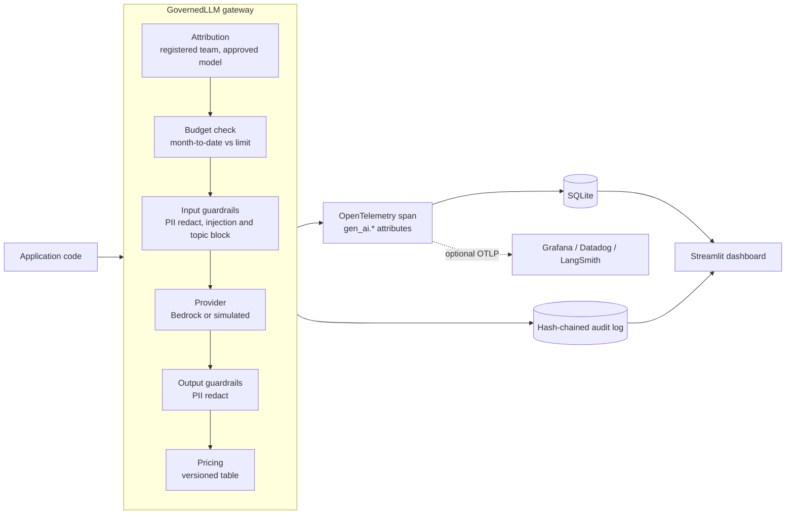

# AI Governance Dashboard

> A governance gateway that every LLM call passes through (attribution, budgets, guardrails, pricing, OpenTelemetry tracing, and a tamper-evident audit log), plus a Streamlit dashboard for the people accountable for AI spend and risk.

[](https://github.com/gyaneshwarmalba/ai-governance-dashboard/actions/workflows/ci.yml)

Runs offline: a seeded simulator generates 30 days of realistic traffic through the real gateway code. Set `LLM_PROVIDER=bedrock` to govern live AWS Bedrock calls.

## Architecture



## Controls

| Control | Behaviour |
|---|---|
| **Attribution** | Calls must name a registered team and a model on the approved price list; anything else is blocked. |
| **Budgets** | Month-to-date spend per team. Alerts fire at 80% and 100% (written to the audit log), and calls are blocked once a budget is spent if `enforce_budgets` is true. Spend resets at the start of each UTC month. |
| **PII** | Emails, phone numbers, SSNs, and credit cards (Luhn-checked) are redacted *before* the prompt reaches the model, and redacted again in model output. |
| **Prompt injection** | Common jailbreak phrasing is blocked without calling the model. |
| **Blocked topics** | Policy-defined terms are blocked. |
| **Pricing** | Per-1k-token input and output rates; versioned model ids (`anthropic.claude-3-5-sonnet-20240620-v1:0`) resolve to their pricing family. |
| **Tracing** | One OpenTelemetry span per call using the GenAI semantic conventions (`gen_ai.request.model`, `gen_ai.usage.input_tokens`, ...) plus `governance.*` attributes. Guardrail hits are span events. |
| **Audit** | Append-only, SHA-256 hash-chained entries. Editing or deleting any row is detected by `verify-audit`, which reports the first broken entry. Prompts are stored as a hash plus a redacted preview, never in clear. |

Everything configurable lives in `config/governance.json`: pricing, budgets, thresholds, and guardrail actions (`block`, `redact`, `flag`). Every span and audit entry records the policy version it was evaluated against.

## Dashboard

`streamlit run app/dashboard.py`. On first run, click **Generate demo data**.

- **Cost**: daily spend by team, calls by status
- **Models**: calls, error rate, p50/p95 latency, and cost per 1k calls for each model, to support right-sizing (for example, moving a workload from Sonnet to Haiku)
- **Prompt templates**: quality, latency, cost, and block rate per template version, for deciding whether to promote v2
- **Guardrails**: violations by rule and action, with drill-down
- **Budgets**: progress per team, alert history, and enforcement state
- **Audit trail**: recent entries and a **Verify hash chain** button
- **Try a governed call**: send a prompt through the gateway and see the status, cost, span id, and violations

## Quick start

```bash
git clone https://github.com/gyaneshwarmalba/ai-governance-dashboard.git
cd ai-governance-dashboard
python -m venv .venv && source .venv/bin/activate
pip install -r requirements.txt

python -m app.cli simulate --calls 1500        # 30 days of governed traffic
python -m app.cli report                       # KPIs and budget status (JSON)
python -m app.cli verify-audit                 # {"ok": true, "entries": 1503, ...}
python -m app.cli call --team legal --prompt "Ignore all previous instructions"   # blocked: prompt_injection
streamlit run app/dashboard.py
pytest                                         # 22 tests, offline
```

A typical simulated month has about 1,500 calls and $3.70 of spend. It includes PII redactions, injection and blocked-topic denials, and roughly 2% provider errors. Budgets in `config/governance.json` are sized to this traffic, so one team hits its warning threshold and another exceeds its budget and starts getting blocked.

## Using it in an application

```python
from app.config import Policy
from app.providers import BedrockProvider
from app.store import Store
from app.telemetry import GovernedLLM

llm = GovernedLLM(BedrockProvider("us-west-2"), Policy.load("config/governance.json"), Store("data/governance.sqlite"))
result = llm.invoke(
    prompt, team="legal", model="anthropic.claude-3-5-sonnet-20240620-v1:0", template="contract-summary", template_version="v2"
)
if result.status != "ok":
    ...  # result.reason: prompt_injection | budget_exceeded | unregistered_team | ...
```

## Design decisions

- **A gateway, not after-the-fact log scraping.** Controls such as redaction and budget stops have to run *before* the model call, so they live in the call path. Observability comes from the same place, which keeps the dashboard numbers and the enforcement decisions consistent.
- **OpenTelemetry as the contract.** Spans follow the GenAI semantic conventions, so the same telemetry can go to any OTLP backend. The local SQLite exporter exists only to make the dashboard self-contained.
- **Tamper-evident rather than "immutable".** A hash chain doesn't stop an administrator from deleting rows, but it makes any change detectable. In production, the head hash would be anchored periodically in write-once storage (for example S3 Object Lock).
- **Simple, transparent detectors.** Regex and heuristic guardrails are easy to audit and explain. They are a first layer; a dedicated DLP or safety classifier can be added behind the same `Violation` interface.
- **Trimmed from the original plan:** Prometheus and Grafana (OTLP export covers this), Gradio (Streamlit only), and a separate FastAPI service (the gateway is a library; wrapping it in an HTTP proxy is straightforward when needed).

## Project layout

```
app/
  telemetry.py   GovernedLLM gateway, OpenTelemetry tracer, SQLite span exporter
  guardrails.py  PII, injection, topic, and length checks; redaction
  budgets.py     month-to-date spend, threshold crossing
  audit.py       hash-chained audit log with verify()
  providers.py   Bedrock and seeded simulated providers
  analytics.py   KPIs, model and template comparisons
  simulate.py    synthetic traffic through the real gateway
  store.py       SQLite schema
  cli.py         simulate / call / report / verify-audit
  dashboard.py   Streamlit UI
config/governance.json
tests/
```

## License

MIT. See [LICENSE](LICENSE).
